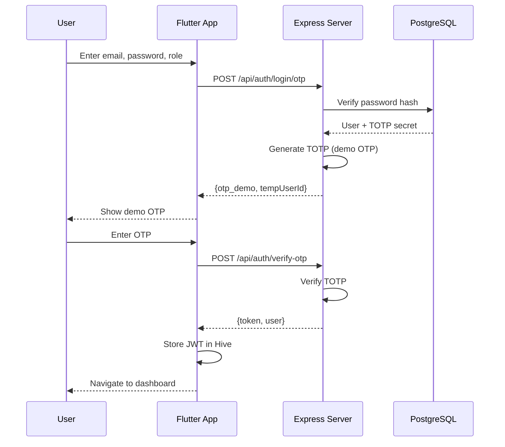
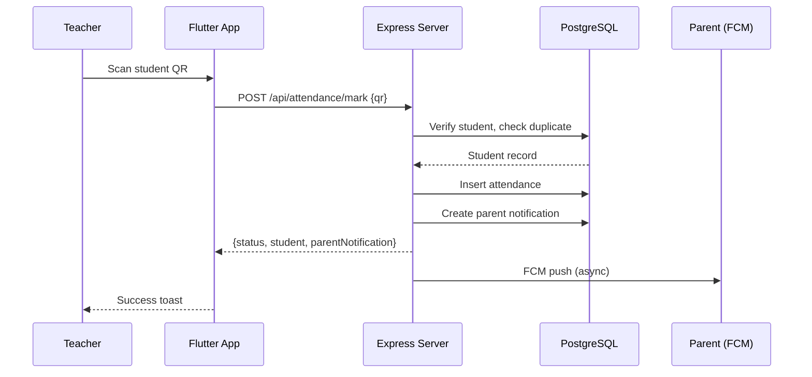

# Architecture Diagram

## System Overview

```mermaid
graph TB
    subgraph "Client Layer"
        A[Flutter App<br/>Android/iOS/Web]
    end

    subgraph "API Gateway / Load Balancer"
        B[Nginx Reverse Proxy<br/>SSL Termination]
    end

    subgraph "Application Layer"
        C[Express.js Server<br/>Port 4000]
    end

    subgraph "Data Layer"
        D[(PostgreSQL<br/>Neon/Docker)]
        E[Redis<br/>(Future: Session Cache)]
    end

    subgraph "External Services"
        F[Google Gemini AI<br/>AI Tutor]
        G[Razorpay<br/>Fee Payments]
        H[Firebase FCM<br/>Push Notifications]
        I[Nmap<br/>Security Scans]
    end

    subgraph "Infrastructure"
        J[WireGuard VPN<br/>Admin Access]
        K[UFW Firewall]
        L[Certbot<br/>Let's Encrypt SSL]
    end

    A -->|HTTPS| B
    B -->|HTTP| C
    C -->|TCP| D
    C -.->|Future| E
    C -->|HTTPS| F
    C -->|HTTPS| G
    C -->|HTTPS| H
    C -->|Local| I
    J -.->|Admin Only| C
    K -.->|Protects| C
    L -.->|SSL for| B
```

## Component Details

### Flutter Client (`lib/`)
- **State Management**: Provider (AuthService, LocaleProvider)
- **Networking**: Dio with interceptors for JWT, offline queue (Hive)
- **UI**: Material 3, custom design system (GlassCard, AppButton, charts)
- **Offline**: Hive boxes for auth tokens, cached data, pending actions
- **Localization**: Hindi/English via `AppLocalizations`

### Express Server (`server/src/`)
- **Entry**: `index.js` - CSP, CORS, rate limiting, error handling, route mounting
- **Auth Middleware**: `middleware/auth.js` - JWT verification, role extraction
- **Validation Middleware**: `middleware/validate.js` - express-validator schemas
- **Database**: `db.js` - pg Pool, Neon-compatible SSL
- **Routes** (modular):
  - `authRoutes.js` - signup, login/otp, verify-otp, me
  - `attendance.js` - students, summary, mark, notifications
  - `homework.js` - create, attach, list
  - `fees.js` - remind (Razorpay), attach
  - `grades.js` - list (parent sees child's)
  - `chat.js` - send (encrypted), history
  - `security.js` - scan (nmap localhost)
  - `dashboard.js` - admin/teacher/parent aggregated data
  - `adminUsers.js` - CRUD, status, password reset, audit logs, export
  - `ai.js` - ask (Gemini with retries/fallback)
- **Services**:
  - `aiTutorService.js` - Gemini with timeout, retry, fallback model
  - `initDb.js` - schema creation + demo seeding (prod-safe)
- **Utils**:
  - `crypto.js` - AES encryption (fails fast if key missing)
  - `audit.js` - security event logging
  - `notify.js` - notification creation

### Database (PostgreSQL)
- **Users**: auth, roles, TOTP, status, audit fields
- **Students**: profile, QR codes, parent linkage
- **Attendance**: QR-based marking, parent notifications
- **Grades**: student-subject-term scores
- **Homework**: teacher-created, file metadata
- **Fees**: records + Razorpay integration, file metadata
- **Messages**: AES-encrypted chat
- **Notifications**: typed, read/unread tracking
- **Audit Logs**: security-relevant actions with metadata

### Security Features
- JWT (HS256, 7-day expiry) + TOTP 2FA (120s step)
- Role-based access control (admin > teacher > parent > student)
- CSP, HSTS, Referrer-Policy via Helmet
- CORS origin whitelist
- Rate limiting: 200/15min general, 20/15min auth, 10/min AI
- Input validation on all mutating endpoints
- AES-256 chat encryption (server-side)
- Audit logging for security events
- Nmap restricted to localhost
- WireGuard VPN for admin access

### Deployment (Ubuntu + Docker)
- Docker Compose: Postgres + Express
- Nginx reverse proxy (80/443 -> 4000)
- Certbot for Let's Encrypt SSL
- UFW: SSH, HTTP, HTTPS, WireGuard UDP
- WireGuard VPN for admin network access
- Certbot auto-renewal via systemd timer

## Data Flow Examples

### Login Flow


### Attendance Marking


## API Request/Response Patterns

All mutating endpoints use express-validator schemas. Error responses:
```json
{
  "error": "Validation failed",
  "details": [
    {"path": "email", "msg": "Valid email required"}
  ]
}
```

Success responses wrap data:
```json
{
  "status": "created",
  "student": { "id": 1, "name": "Aarav", "qrCode": "..." }
}
```

## Technology Versions
- Flutter: 3.x (Dart 3.x)
- Node.js: 20 LTS
- PostgreSQL: 16 (Neon) / 16-alpine (Docker)
- Express: 4.18+
- Dio: 5.4+
- Provider: 6.1+
- Hive: 2.2+
- fl_chart: 1.2+
- Google Generative AI: 0.24+