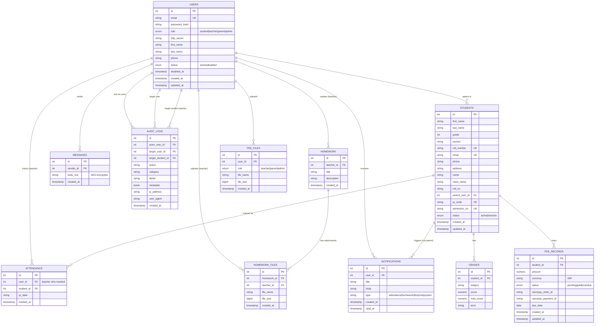

# Entity-Relationship Diagram

## ER Diagram (Mermaid)



## Relationship Summary

| Parent Entity | Child Entity | Relationship | Cardinality | Notes |
|--------------|--------------|--------------|-------------|-------|
| USERS | ATTENDANCE | marks | 1:N | Teacher marks attendance |
| USERS | HOMEWORK | creates | 1:N | Teacher creates homework |
| USERS | HOMEWORK_FILES | uploads | 1:N | Teacher attaches files |
| USERS | MESSAGES | sends | 1:N | Chat messages |
| USERS | NOTIFICATIONS | receives | 1:N | All notifications |
| USERS | AUDIT_LOGS | acts | 1:N | Actor in audit |
| USERS | AUDIT_LOGS | targeted | 1:N | Target user |
| USERS | STUDENTS | parent of | 1:N | Parent->child link |
| USERS | FEE_FILES | uploads | 1:N | Fee proof uploads |
| STUDENTS | ATTENDANCE | marked for | 1:N | Student attendance |
| STUDENTS | GRADES | has | 1:N | Academic grades |
| STUDENTS | FEE_RECORDS | owes | 1:N | Fee obligations |
| HOMEWORK | HOMEWORK_FILES | has | 1:N | Attachments |

## Key Constraints & Indexes

```sql
-- Users
CREATE UNIQUE INDEX users_email_unique ON users(email);
CREATE INDEX users_role_idx ON users(role);
CREATE INDEX users_status_idx ON users(status);

-- Students
CREATE UNIQUE INDEX students_qr_code_unique ON students(qr_code);
CREATE UNIQUE INDEX students_admission_no_unique ON students(admission_no);
CREATE INDEX students_parent_user_id_idx ON students(parent_user_id);
CREATE INDEX students_class_name_idx ON students(class_name);

-- Attendance
CREATE INDEX attendance_student_id_idx ON attendance(student_id);
CREATE INDEX attendance_marked_at_idx ON attendance(marked_at);
CREATE INDEX attendance_user_id_idx ON attendance(user_id);

-- Homework
CREATE INDEX homework_teacher_id_idx ON homework(teacher_id);
CREATE INDEX homework_created_at_idx ON homework(created_at DESC);

-- Grades
CREATE INDEX grades_student_id_idx ON grades(student_id);
CREATE UNIQUE INDEX grades_student_subject_term_unique
  ON grades(student_id, subject, term);

-- Fee Records
CREATE INDEX fee_records_student_id_idx ON fee_records(student_id);
CREATE INDEX fee_records_status_idx ON fee_records(status);

-- Messages
CREATE INDEX messages_sender_id_idx ON messages(sender_id);
CREATE INDEX messages_created_at_idx ON messages(created_at DESC);

-- Notifications
CREATE INDEX notifications_user_id_idx ON notifications(user_id);
CREATE INDEX notifications_read_at_idx ON notifications(read_at);
CREATE INDEX notifications_type_idx ON notifications(type);

-- Audit Logs
CREATE INDEX audit_logs_actor_user_id_idx ON audit_logs(actor_user_id);
CREATE INDEX audit_logs_target_user_id_idx ON audit_logs(target_user_id);
CREATE INDEX audit_logs_created_at_idx ON audit_logs(created_at DESC);
CREATE INDEX audit_logs_category_idx ON audit_logs(category);
```

## Data Flow Notes

1. **Attendance**: Teacher scans QR → creates Attendance record → creates parent Notification → FCM push to parent
2. **Homework**: Teacher creates → Homework record → optional Homework_files → notifyAllParents() → Notification to all parents
3. **Grades**: Admin/teacher inserts → linked to Student (not User) → Parent dashboard queries via student_id
4. **Chat**: Sender encrypts with MESSAGE_ENC_KEY → stored as body_enc → decrypt on read → notify opposite role
5. **Fees**: Teacher creates fee_remind → Razorpay order → notifyAllParents() → Parent uploads proof → fee_files → notifyAllTeachers()
6. **Audit**: All security actions (login, user CRUD, password reset, attendance) → audit_logs with actor, target, metadata
7. **AI Tutor**: User asks → JWT verified → Gemini API with retry/fallback → response returned

## Soft Deletes & Status Fields

- `users.status`: 'active' | 'disabled' (soft delete via disabled_at)
- `students.status`: 'active' | 'inactive'
- `fee_records.status`: 'pending' | 'paid' | 'overdue'
- `notifications.read_at`: NULL = unread, timestamp = read

No hard deletes on core entities; use status fields for lifecycle management.